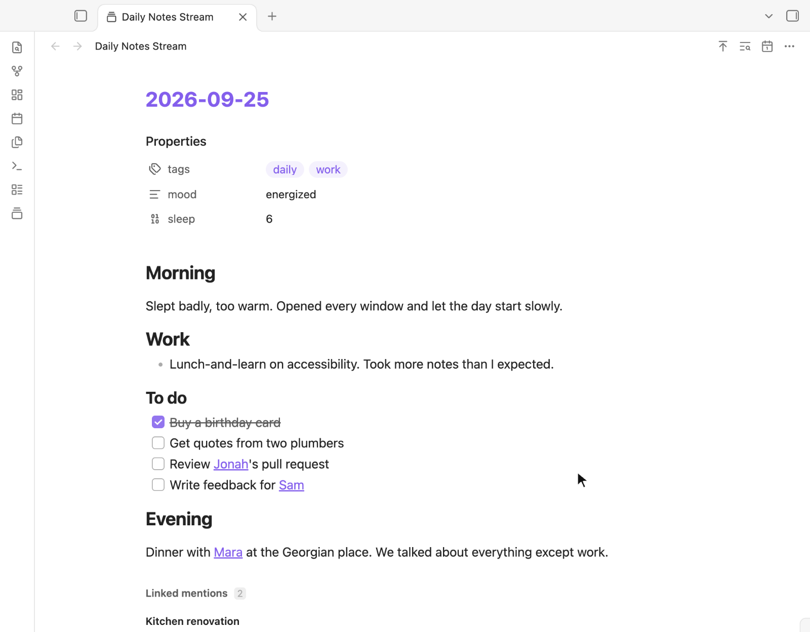
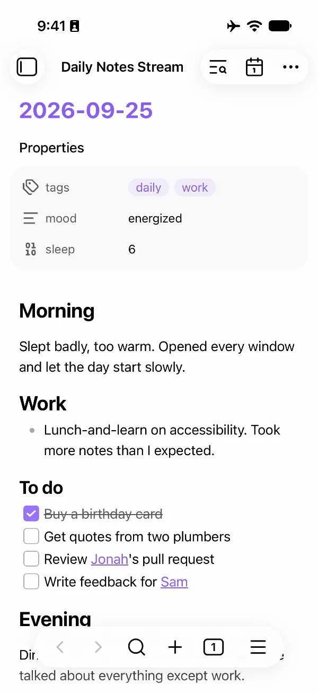

# Daily notes stream

Read your daily notes like a journal. Every day appears on one page, with the
newest at the top and older days loading as you scroll. The stream is for
reading; to edit a note, click its date.

It works with the daily notes you already have. There's no new folder, format or
template to set up, and it never changes your notes.

<p></p>

## Features

- **One stream.** Every daily note appears on one scrolling page, newest first,
  including notes in nested folders such as `2025/03/2025-03-04.md`.
- **Always current.** When you create, edit, rename or delete a note, the stream
  updates right away.
- **[Search](#search).** Press Ctrl/Cmd+F to find text across every note.
- **[Jump to a date](#move-around).** Go straight to any day that has a note.
- **[Fold sections](#fold-sections).** Collapse any heading or nested list, and
  the stream remembers it.
- **Properties.** Each note's properties appear at its top. You can hide or
  collapse them in [settings](#settings).
- **[Linked mentions](#linked-mentions).** Each note ends with the notes that
  link to it. You can hide or collapse them in [settings](#settings).
- **[Full notes](#open-the-stream).** Images, embeds, links, tasks and Bases
  look just as they do in Obsidian.
- **[Phone and tablet](#phone-and-tablet).** Tables and Bases too wide for the
  screen are shown as cards.

## Before you install

| Question                               | Answer                                                                                                                                                                                                                                                 |
| -------------------------------------- | ------------------------------------------------------------------------------------------------------------------------------------------------------------------------------------------------------------------------------------------------------ |
| Which notes does it show?              | The notes in the folder set in **Settings → Daily notes**, including its subfolders, whose names match the date format set there. If you use Periodic Notes with its daily notes turned on, the stream uses Periodic Notes' folder and format instead. |
| Can I edit in the stream?              | No. Click a note's date to open it for editing. The stream updates as you type.                                                                                                                                                                        |
| Does it change my notes?               | No. It only reads them.                                                                                                                                                                                                                                |
| What does it store?                    | Your settings, saved in the plugin's folder. Which sections you folded, and layout measurements that keep scrolling steady, are kept separately on each device.                                                                                        |
| Does it go online?                     | No. The only things that load from the web are embeds you put in your notes yourself, such as videos.                                                                                                                                                  |
| Does it slow down with years of notes? | No. Only the notes near what you're reading are loaded at a time, and it's tested on three years of daily notes.                                                                                                                                       |
| Which devices does it run on?          | Desktop and mobile. It needs Obsidian 1.14.4 or later.                                                                                                                                                                                                 |
| Does it work with other plugins?       | Notes look just as they do in Obsidian, including Dataview tables and Bases. Templates made with the core Templates plugin or with Templater are recognised when empty notes are hidden; see [Empty notes](#empty-notes).                              |

If you want to edit notes directly inside the feed, this plugin doesn't do that,
but
[Daily Notes Editor](https://github.com/Quorafind/Obsidian-Daily-Notes-Editor)
does.

## Install

1. From the
   [latest release](https://github.com/madhurya27/daily-notes-plugin/releases/latest),
   download `main.js`, `manifest.json` and `styles.css`.
2. Put them in `<Vault>/.obsidian/plugins/daily-notes-stream/`. Create the
   folder if it doesn't exist; `.obsidian` is hidden in most file browsers.
3. Reload Obsidian.
4. Enable **Daily notes stream** in **Settings → Community plugins**.

On a phone or tablet, install the plugin on a computer first and let your sync
service copy the plugin folder to the device. Then enable it there.

To build from source instead, run `pnpm run build` and copy the same three files
to the same folder.

## Use

### Open the stream

Click the ribbon icon (a stack of cards), or run
`Daily notes stream: Open stream` from the command palette (Ctrl/Cmd+P). It
opens in the current tab; Ctrl/Cmd-click the icon to open it in a new tab.

Each note looks just as it does in Obsidian, with its properties, images,
embeds, links, tasks and Bases.


### Empty notes

A daily note that holds nothing, or only the text of your daily-notes template,
is left out of the stream. It appears as soon as you write in it or change one
of its properties.

Some empty notes still show. Today's note always does, and so does a note that
another note links to, so you can see its linked mentions. A note made from an
older version of your template shows too, because it no longer matches the
current one.

Templates made with the core Templates plugin or with Templater both work. Some
Templater commands produce text that can't be known in advance: commands that
write several lines, such as `tp.file.include`, and commands that choose between
sections. A note made from a template that uses them shows even before you write
in it.

To show every note, turn off **Hide empty notes** in [settings](#settings).

### Move around

| To                    | Do                                                                             |
| --------------------- | ------------------------------------------------------------------------------ |
| Load older notes      | Scroll down                                                                    |
| Go back to the newest | Run `Daily notes stream: Scroll to top`, or on mobile tap the title at the top |
| Go to a date          | Click the calendar icon at the top, or run `Daily notes stream: Jump to date`  |

The jump list shows every day that has a note. You can type a date in your
daily-note format or as `YYYY-MM-DD`. If that day has no note, you go to the
closest earlier day that does. The calendar button in the list opens your
device's date picker.


### Search

Press Ctrl/Cmd+F, or click the search icon at the top. If you changed Obsidian's
"Search current file" shortcut, use yours.

| Key         | Action                 |
| ----------- | ---------------------- |
| Enter       | Next matching note     |
| Shift+Enter | Previous matching note |
| Escape      | Close search           |

Search looks only at each note's own text. Content that comes from other notes,
such as a Base, an embedded note or linked mentions, isn't searched. If a match
is inside a folded section, search unfolds it. If the counter reads
`2 / 5 · hidden`, the match is in a part of the note that isn't shown, such as
hidden properties or an embed.


### Fold sections

Click the arrow beside a heading or nested list to fold it. The stream remembers
what you folded.


### Linked mentions

Each note ends with a list of the notes that link to it, quoting the lines
around each link.


### Open notes and links

Note dates, links inside notes, and the notes and links in linked mentions all
open the way links do elsewhere in Obsidian:

| Gesture                        | Opens                                           |
| ------------------------------ | ----------------------------------------------- |
| Click                          | In the stream's tab; Back returns to the stream |
| Ctrl/Cmd-click or middle-click | In a new tab                                    |
| Ctrl/Cmd+Alt-click             | Side by side, in a split                        |
| Right-click                    | The file menu                                   |

Click a tag to search for it, or Ctrl/Cmd-click it to search in a new tab. Hold
Ctrl/Cmd while hovering over a link to preview it. To preview without holding
the key, open **Settings → Page preview** and turn off the switch for "Daily
notes stream".

### Phone and tablet

On a phone or tablet, nothing inside a note scrolls on its own, so one swipe
moves the whole stream. Content that would need its own scrolling is reshaped
instead:

| Content                      | Becomes                                                                             |
| ---------------------------- | ----------------------------------------------------------------------------------- |
| Table                        | A card per row, each value under its column's name                                  |
| Base                         | Narrower columns; if that isn't enough, a card per note, using Bases' own card view |
| Kanban Base                  | Cards, each column a group                                                          |
| Equation                     | Smaller, to fit the width                                                           |
| Code block                   | Long lines wrap                                                                     |
| Diagram                      | Smaller, to fit the width (on desktop too)                                          |
| Embedded note                | Shown in full, not in a box of its own that scrolls                                 |
| Any other embed that scrolls | Cut off at its edge                                                                 |

On desktop, wide tables and code blocks scroll sideways in their own box, as
they do in Obsidian.

<p></p>

<details>
<summary>Phone layout</summary>

<p>      </p>

</details>

## Settings

- **Hide empty notes** (on by default) leaves out daily notes you never wrote
  in. See [Empty notes](#empty-notes).
- **Properties**
    - **Show note properties** (on by default) shows each note's properties.
    - **Collapse properties by default** (off by default) starts each note with
      its properties folded.
- **Linked mentions**
    - **Show linked mentions** (on by default) shows the notes that link to each
      note.
    - **Collapse linked mentions by default** (off by default) starts them
      folded.

Each collapse setting appears only while its section is shown.

The stream follows Obsidian's theme, light or dark.


## Troubleshooting

| You see                                         | What to do                                                                                                           |
| ----------------------------------------------- | -------------------------------------------------------------------------------------------------------------------- |
| "No daily notes found"                          | Make sure the folder and date format in **Settings → Daily notes** match where your notes are and how they're named. |
| "Every daily note is hidden"                    | Every daily note holds only its template, so all of them are hidden. Write in one, or turn off **Hide empty notes**. |
| A note you expected is missing                  | Either it holds only its template (see [Empty notes](#empty-notes)), or its name doesn't match the date format.      |
| The plugin isn't listed under Community plugins | Make sure the three files sit directly in `daily-notes-stream/`, not in a subfolder, then reload Obsidian.           |

## Development

```bash
pnpm install && pnpm test && pnpm run lint && pnpm run build
```

## License

MIT
