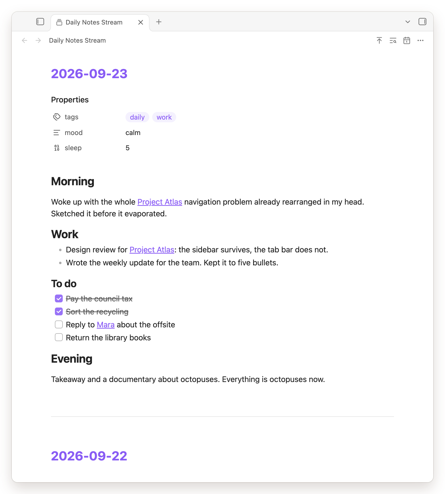

# Daily notes stream

A read-only, infinite-scroll feed of all your Obsidian Daily Notes, newest first.

## Screenshots

| | Desktop | Phone |
| --- | --- | --- |
| Every daily note, newest first |  |  |
| Search the whole stream |  |  |
| Jump to a date |  |  |
| Collapse sections |  |  |
| Bases render in place |  |  |

## Features

- Continuous stream sorted newest-first with infinite scroll (batch 10)
- Live updates — new/modified/renamed/deleted notes reflect instantly
- Collapsible headers (H1–H6) and nested lists
- Search the whole stream, note by note, with the vault's own find hotkey
- Frontmatter properties panel, shown by default (toggleable, collapsible, native-styled)
- Nested folder support (e.g. `Notes/2025/03/2025-03-04.md`)
- Full Markdown rendering: images, embeds, wikilinks, tasks
- Matches your Obsidian theme via native CSS variables
- Mobile friendly: on a phone or tablet, a table or Base too wide for the note becomes cards

## Installation

**From release**: extract to `<Vault>/.obsidian/plugins/daily-notes-stream/`.  
**From source**: `pnpm run build`, then copy `main.js`, `manifest.json`, `styles.css` to the same path.

Reload Obsidian and enable **Daily notes stream** in **Settings → Community Plugins**.

## Usage

Open via the ribbon icon (a stack of cards) or command palette (`Daily notes stream: Open stream`). Like the
graph, it opens in the current tab; mod-click the ribbon icon for a new one.

- Scroll down to load older notes. `Daily notes stream: Scroll to top` glides back to the newest; on mobile,
  so does a tap on the title in the view header.
- Jump to a date from the calendar action in the view header, or `Daily notes stream: Jump to date`. The
  prompt lists the days your vault has a note for, spelled the way your daily-note format spells them, and
  narrows as you type — in that format or in `YYYY-MM-DD`. The calendar button opens your platform's own date
  wheel. A date with no note is still offered, as one entry saying it will land on the nearest older one.
- Search with Obsidian's "Search current file" hotkey or the header's search action. It counts matching notes
  across the whole vault; Enter and Shift+Enter step through them, opening collapsed sections on the way,
  Escape closes. `· hidden` marks a note whose match isn't drawn, such as in frontmatter.
- Click a date header to open the original file in the stream's tab; Back returns to where you were. Date
  headers and links inside notes follow Obsidian: mod-click or middle-click opens a new tab, mod-alt-click a
  split, right-click (long-press on mobile) the file menu.
  Mod-hover a link to preview it; Page preview's settings list the stream as "Daily notes stream".
- Click a tag, inline or in the properties panel, to search for it; mod-click opens the search in a new pane.
- **Settings**: toggle note properties display and default collapse state.

## Development

```bash
pnpm install && pnpm test && pnpm run lint && pnpm run build
```

## License

MIT
