# Daily notes stream

Read your daily notes like a journal: every day on one page, newest at the top, older days as you scroll. The
stream is for reading; click a note's date to open it for editing.

<p>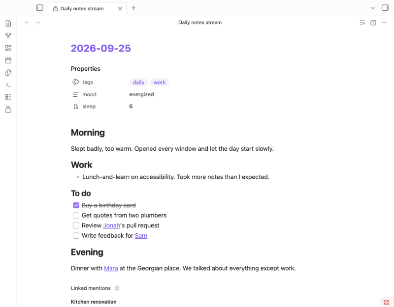</p>

## Features

- **One stream.** Every daily note, newest first, including notes in nested folders like `2025/03/2025-03-04.md`.
- **Always current.** New, edited, renamed and deleted notes show up straight away.
- **[Search](#search).** Find text across every note with Ctrl/Cmd+F.
- **[Jump to a date](#move-around).** Pick any day that has a note.
- **[Fold sections](#fold-sections).** Collapse any heading or nested list.
- **Properties.** Each note's properties show at its top; hide or collapse them in [settings](#settings).
- **[Linked mentions](#linked-mentions).** Each note ends with the notes that link to it; hide or collapse them in
  [settings](#settings).
- **[Full notes](#open-the-stream).** Images, embeds, links, tasks and Bases, shown just as Obsidian shows them.
- **[Phone and tablet](#phone-and-tablet).** Tables and Bases too wide for the screen become cards.

## Install

1. Download the [latest release](https://github.com/madhurya27/daily-notes-plugin/releases/latest) and extract it
   to `<Vault>/.obsidian/plugins/daily-notes-stream/`.
2. Reload Obsidian.
3. Enable **Daily notes stream** in **Settings → Community plugins**.

To build from source instead: `pnpm run build`, then copy `main.js`, `manifest.json` and `styles.css` to the same
folder.

## Use

### Open the stream

Click the ribbon icon (a stack of cards), or run `Daily notes stream: Open stream` from the command palette
(Ctrl/Cmd+P). It opens in the current tab; Ctrl/Cmd-click the icon to open it in a new tab.

Each note looks just as it does in Obsidian: properties, images, embeds, links, tasks and Bases.

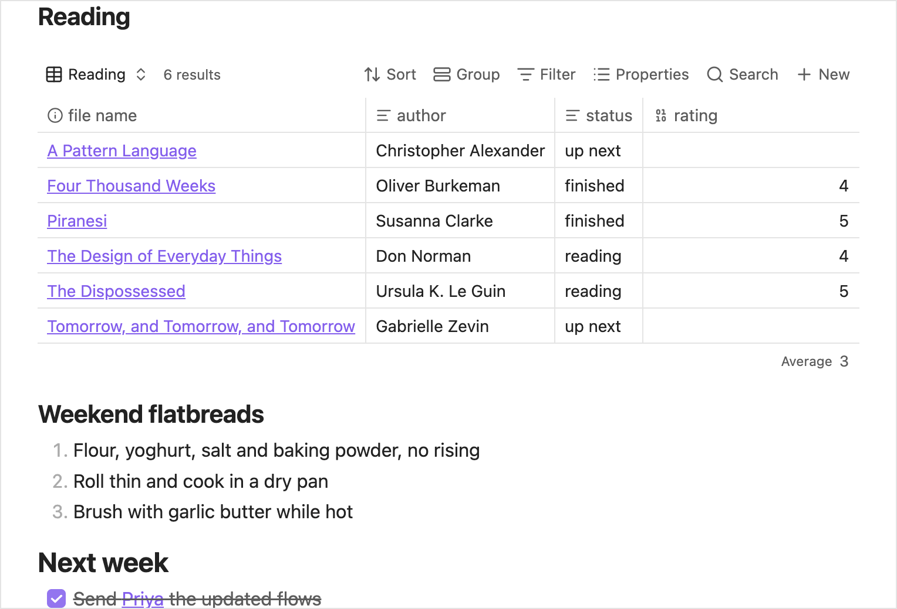

### Empty notes

A daily note that holds only your daily-notes template, or nothing, is left out of the stream. Once you write in
it, or change one of its properties, it appears. Today's note always shows, and so does one another note links to,
for its linked mentions. A note made from an older version of the template counts as written.

### Move around

| To | Do |
| --- | --- |
| Load older notes | Scroll down |
| Go back to the newest | Run `Daily notes stream: Scroll to top`, or on mobile tap the title at the top |
| Go to a date | Click the calendar icon at the top, or run `Daily notes stream: Jump to date` |

The list shows the days that have a note. Type a date in your daily-note format or as `YYYY-MM-DD`. If that day
has no note, you go to the closest earlier one. The calendar button in the list opens your device's date picker.

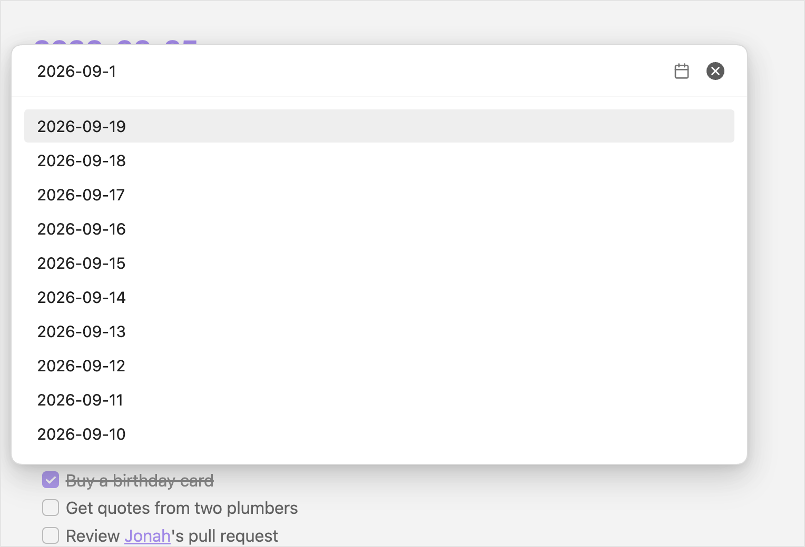

### Search

Press Ctrl/Cmd+F, or click the search icon at the top. If you changed Obsidian's "Search current file" shortcut,
use yours.

| Key | Action |
| --- | --- |
| Enter | Next matching note |
| Shift+Enter | Previous matching note |
| Escape | Close search |

Search opens collapsed sections to show a match. If the counter reads `2 / 5 · hidden`, the note matched in a part
that isn't shown, such as hidden properties or an embed.

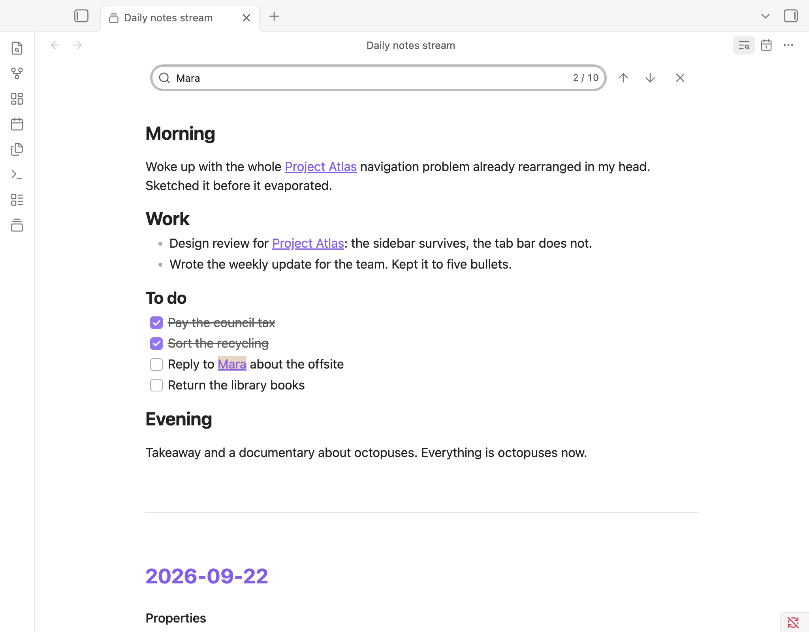

### Fold sections

Click the arrow beside a heading or nested list to fold it. The stream remembers what you folded.

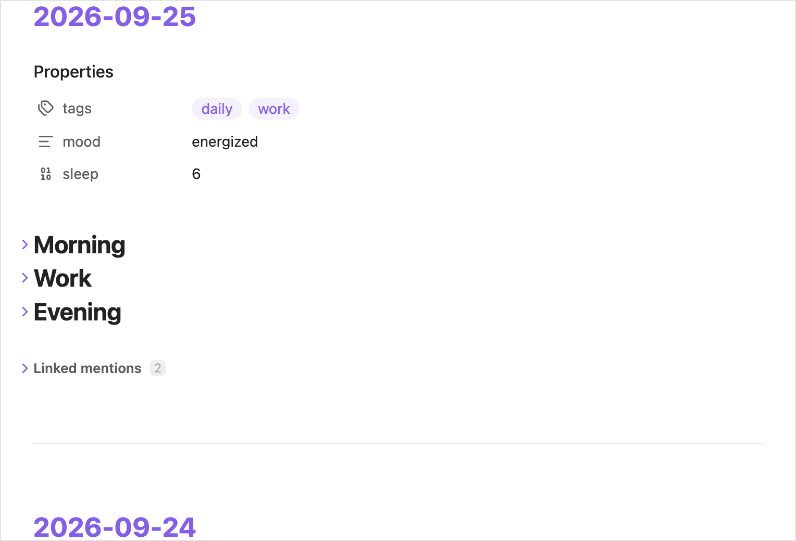

### Linked mentions

Each note ends with a list of the notes that link to it, quoting the lines around each link.

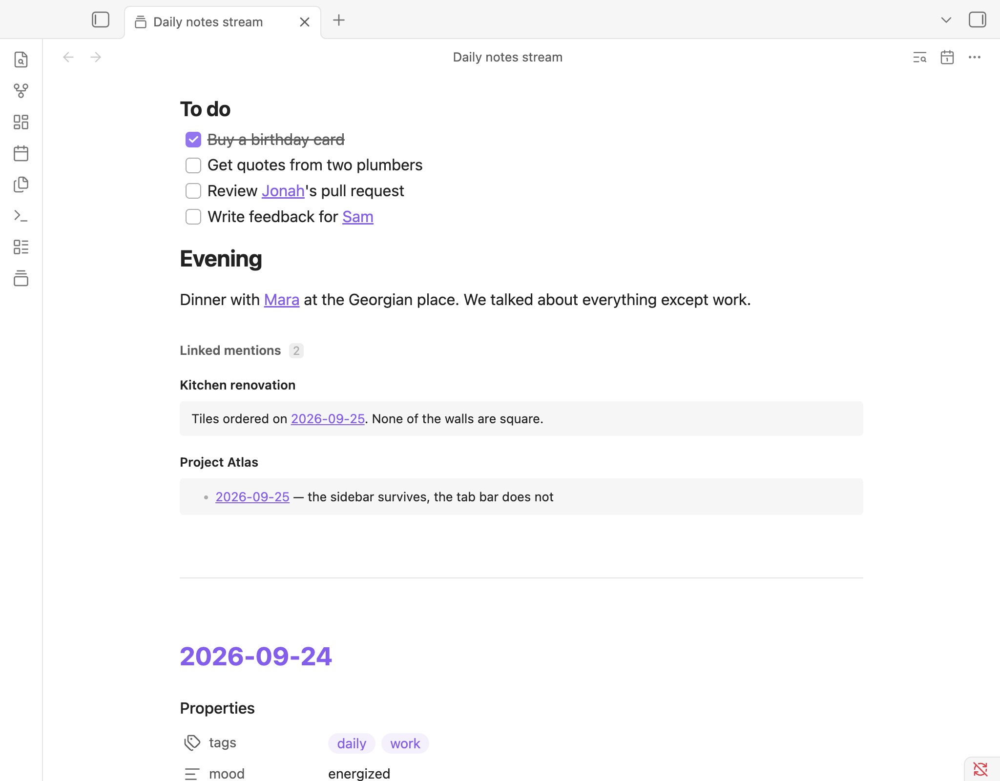

### Open notes and links

The date at the top of each note, links inside notes, and the notes and links in linked mentions open like any
link in Obsidian:

| Gesture | Opens |
| --- | --- |
| Click | In the stream's tab; Back returns to the stream |
| Ctrl/Cmd-click or middle-click | In a new tab |
| Ctrl/Cmd+Alt-click | Side by side, in a split |
| Right-click (long-press on mobile) | The file menu |

Click a tag to search for it; Ctrl/Cmd-click to search in a new tab. Hold Ctrl/Cmd while hovering over a link
to preview it. To preview without holding the key, open **Settings → Page preview** and turn off the switch for
"Daily notes stream".

### Phone and tablet

On a phone or tablet, nothing inside a note scrolls on its own, so one swipe moves the whole stream. Content that
would need its own scrolling is reshaped instead:

| Content | Becomes |
| --- | --- |
| Table | A card per row, each value under its column's name |
| Base | Narrower columns; if that isn't enough, a card per note, using Bases' own card view |
| Equation | Smaller, to fit the width |
| Code block | Long lines wrap |
| Diagram | Smaller, to fit the width (on desktop too) |
| Embedded note | Shown in full, not in a box of its own that scrolls |
| Any other embed that scrolls | Cut off at its edge |

On desktop, wide tables and code blocks scroll sideways in their own box, as they do in Obsidian.

<details>
<summary>Phone layout</summary>

<p>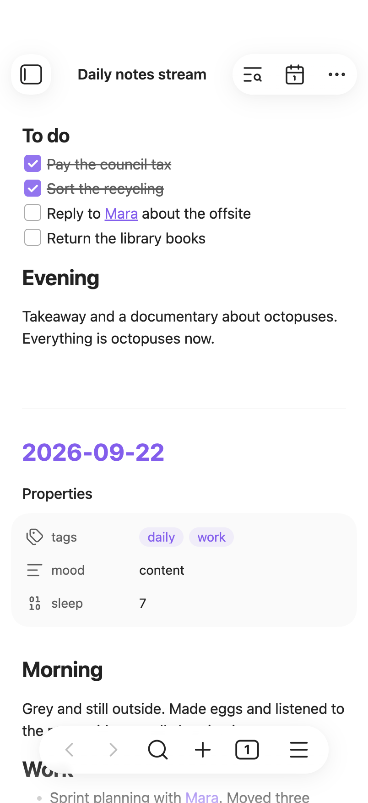 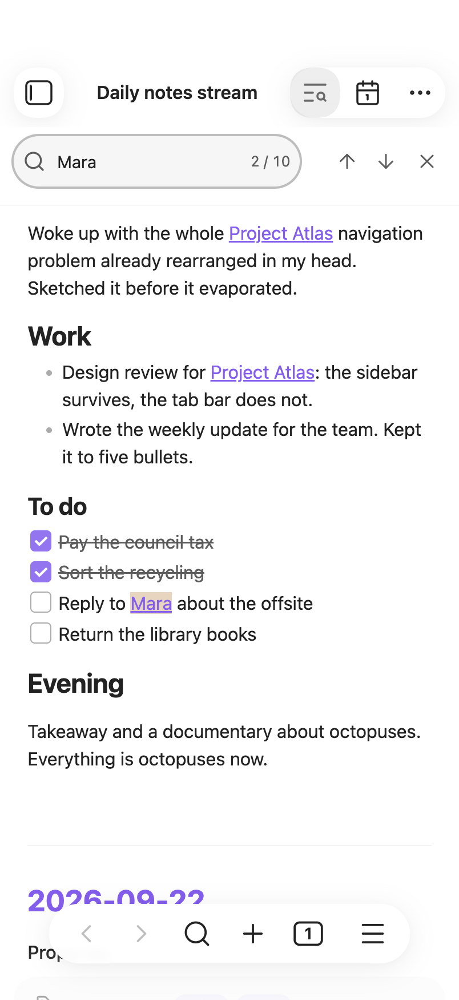 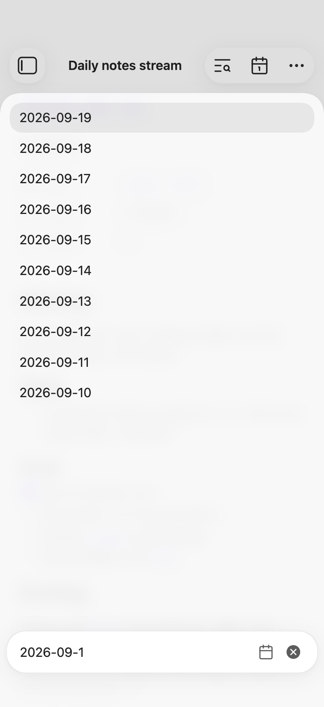 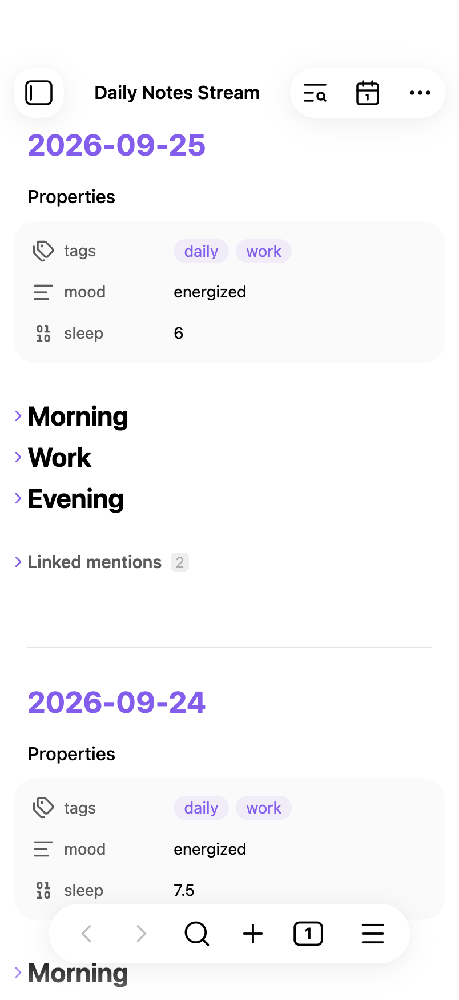 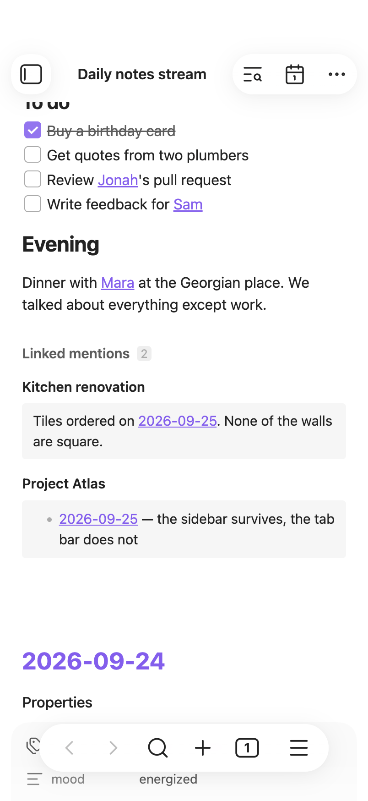 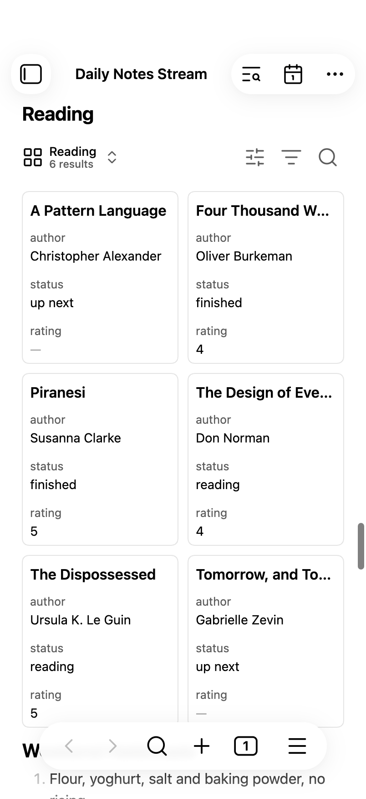 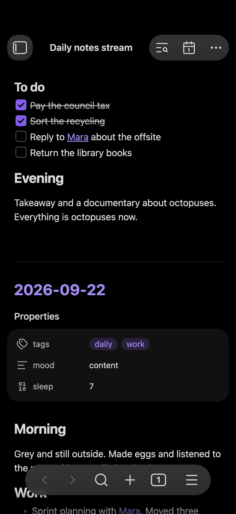</p>

</details>

## Settings

- **Show note properties** (on): show or hide each note's properties.
- **Collapse properties by default** (off): start with the properties folded.
- **Show linked mentions** (on): show or hide the notes linking to each note.
- **Collapse linked mentions by default** (off): start with them folded.
- **Hide empty notes** (on): leave out daily notes you never wrote in. See [Empty notes](#empty-notes).

The stream follows Obsidian's theme, light or dark.

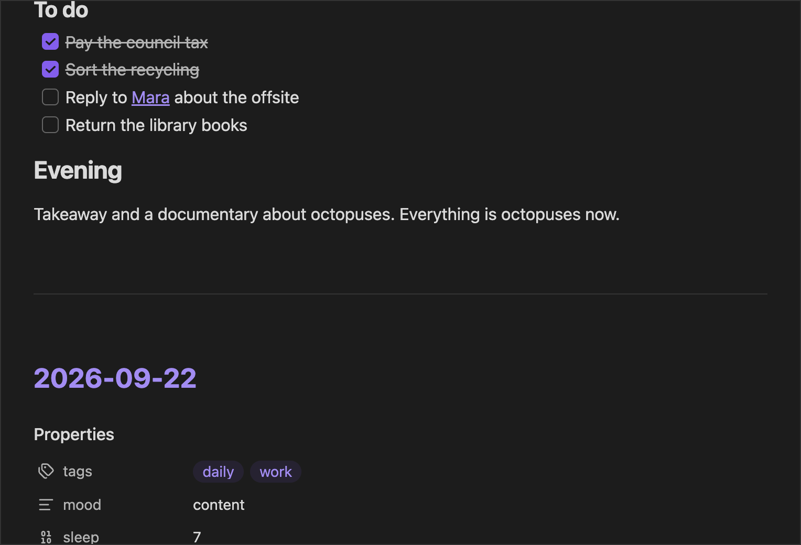

## Development

```bash
pnpm install && pnpm test && pnpm run lint && pnpm run build
```

## License

MIT
